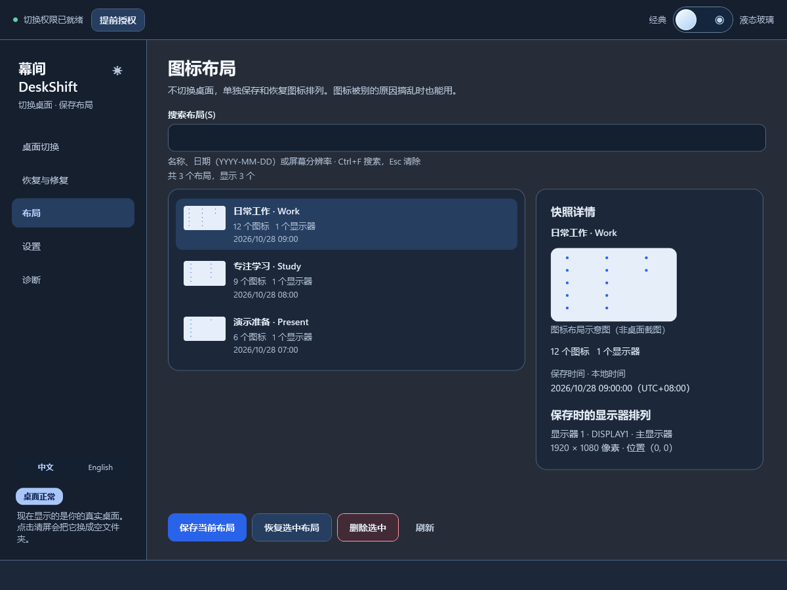
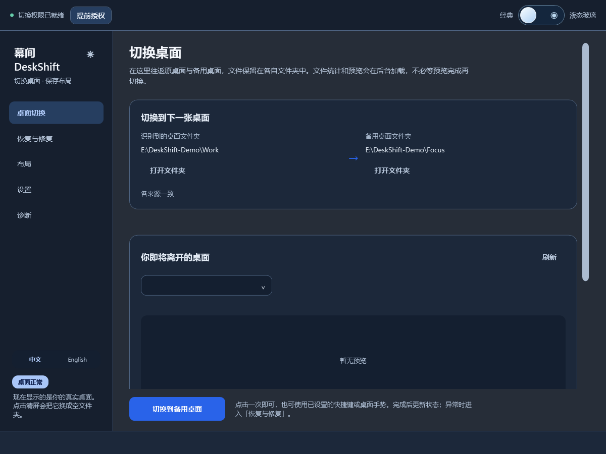
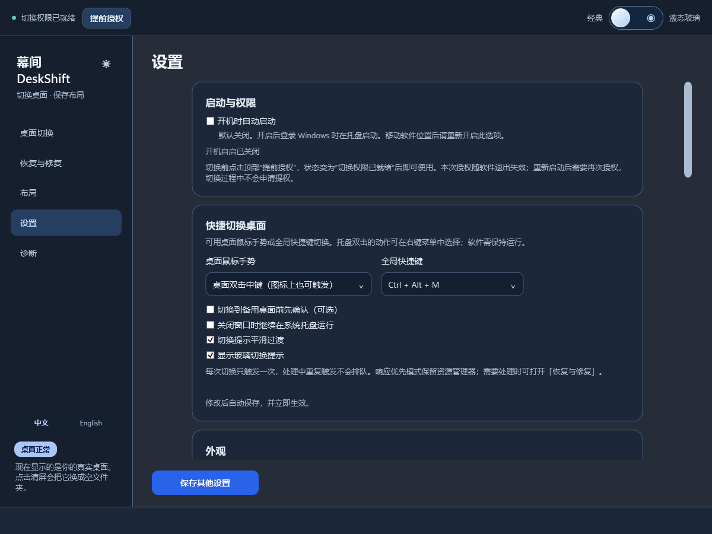
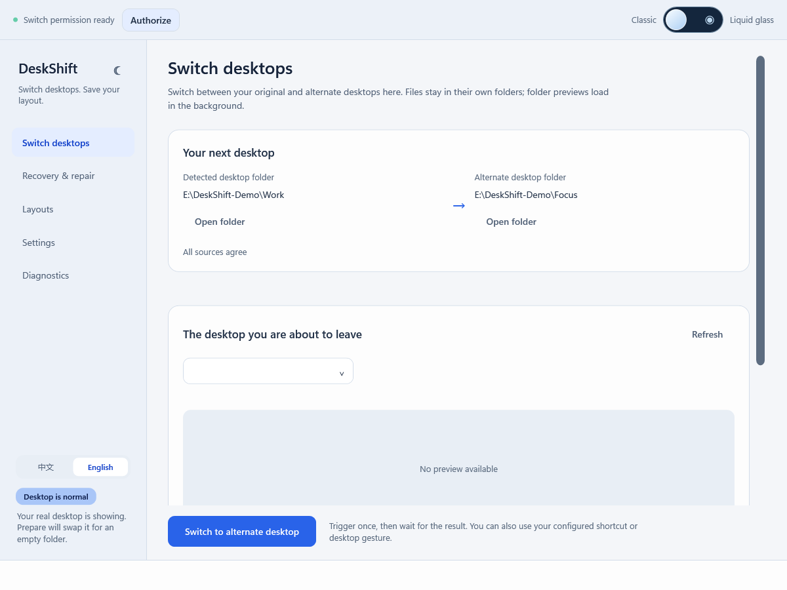

# 幕间 DeskShift

一键切换桌面，保留每个空间的布局。为工作、学习、录屏或演示使用独立的桌面文件夹，返回时按保存的位置恢复图标。

*Switch desktop spaces. Keep your icon layouts. A Windows desktop switcher for work, study and presentations.*

**简体中文** · [English](README.en.md)

[下载 V1.0 · Windows x64](https://github.com/Dream-yd/DeskShift/releases/tag/v1.0.0) · [使用与恢复说明](docs/USAGE.zh-CN.md) · [更新记录](CHANGELOG.md) · [开发与测试](docs/DEVELOPMENT.md)

**Windows 桌面应用 · 中英双语 · 深浅色主题 · .NET 10 自包含发行包**



*V1.0 界面截图，目录和布局均为演示数据。Layout manager in dark mode, shown with demo data.*

## 功能

- 在原桌面与备用文件夹之间切换，返回时按图标身份及位置尝试恢复。
- 通过软件页面、全局快捷键、桌面中键双击或系统托盘操作；快捷方式可以关闭或更改。
- 保存和查看图标布局，按需保留自动快照；当前恢复所需的快照受到保护。
- 中英文、深浅色和跟随系统主题；可选液态玻璃皮肤、切换提示及过渡。
- 提供恢复和诊断入口；遇到无法确认的状态时保留记录，提示人工处理。

## 界面展示

以下截图使用 V1.0 的实际界面控件和隔离的演示数据。没有载入个人桌面预览，路径和布局名称均为示例；截图不代表兼容性或性能测试结果。

<details open>
<summary><strong>桌面切换 · 深色中文界面 / Desktop switching · Chinese, dark</strong></summary>

在同一页面往返原桌面与备用桌面，查看当前文件夹和目标文件夹。「恢复与修复」用于异常状态处理。



</details>

<details>
<summary><strong>快捷操作与设置 / Shortcuts and settings</strong></summary>

设置全局快捷键、桌面中键双击、托盘运行、过渡动画和切换提示；支持可选开机自启与提前授权。



</details>

<details>
<summary><strong>浅色英文界面 / English interface in light mode</strong></summary>

侧边栏直接切换中文与 English；外观支持深色、浅色与跟随系统。



</details>

## 使用前

个人桌面文件保留在各自文件夹中；软件通过更改 Windows 桌面文件夹位置实现切换。公共桌面的 `.lnk` 快捷方式可能需要管理员授权来暂存与恢复。授权提示的时机取决于是否已有有效授权，并非保证每次切换都会弹窗。

1. 备份重要桌面文件，确认知道原桌面文件夹的位置，并在软件中保存一份布局。
2. 在设置中选择独立的备用文件夹；不要使用原桌面或其子目录。
3. 按需选择提前授权，并在“桌面切换”页操作；切回原桌面后核对图标排列。
4. 出现异常时打开“恢复与修复”或“诊断”。不要自行删除恢复记录或自动快照。

响应优先模式尝试不重启 Explorer；兼容模式可能重启 Explorer 并关闭资源管理器窗口。软件默认数据位于 `%LOCALAPPDATA%\MeetingDesktop`，可通过设置入口导出恢复备份。详见[使用与恢复说明](docs/USAGE.zh-CN.md)。

## 安装与构建

从 [GitHub Releases](https://github.com/Dream-yd/DeskShift/releases) 下载 Windows x64 发行包；解压后保留整个文件夹，运行 `MeetingDesktop.exe`。自包含包不需要另装 .NET 运行时。

升级前先退出旧版托盘进程。为兼容已有配置、恢复记录、自启项和辅助进程，V1.0 保留 `MeetingDesktop.exe` 文件名及 `%LOCALAPPDATA%\MeetingDesktop` 数据目录，无需搬迁旧数据。启用了开机自启的用户，可在设置中将旧入口迁移到新版本。发行包未签名。

从源码构建需要 Windows、.NET 10 SDK 和网络可访问的 NuGet 源：

```powershell
dotnet restore MeetingDesktop.sln
dotnet build MeetingDesktop.sln -c Release --no-restore
dotnet test MeetingDesktop.sln -c Release --no-build
```

测试包含在独立窗口上运行的 Windows 原生测试；完整真实桌面往返不包含在自动化测试中。发布包为多文件自包含部署，不要把 EXE 单独移出文件夹。

## 版本与验证范围

当前为 **V1.0 正式版**，原名「会议桌面 Meeting Desktop」。879 项本机自动测试通过，1 项因符号链接权限跳过；Windows CI 已通过。单屏 Windows 11 虚拟机验证了多次真实往返、图标位置恢复、静态壁纸下的渐显画面，以及稳定备用状态下结束程序后重启返回。

动态壁纸、多屏/混合缩放、切换中途崩溃及默认 UAC 交互仍需更多实机验收。图标、权限或显示器状态变化时，恢复可能不完整。首次使用请备份重要文件与布局。详见 [V1.0 发布说明](https://github.com/Dream-yd/DeskShift/releases/tag/v1.0.0)。

## 许可证

项目许可证为 [MIT](LICENSE)。液态玻璃实现参考了第三方项目的光学思路；详细归属和许可证见[第三方声明](THIRD-PARTY-NOTICES.md)。
